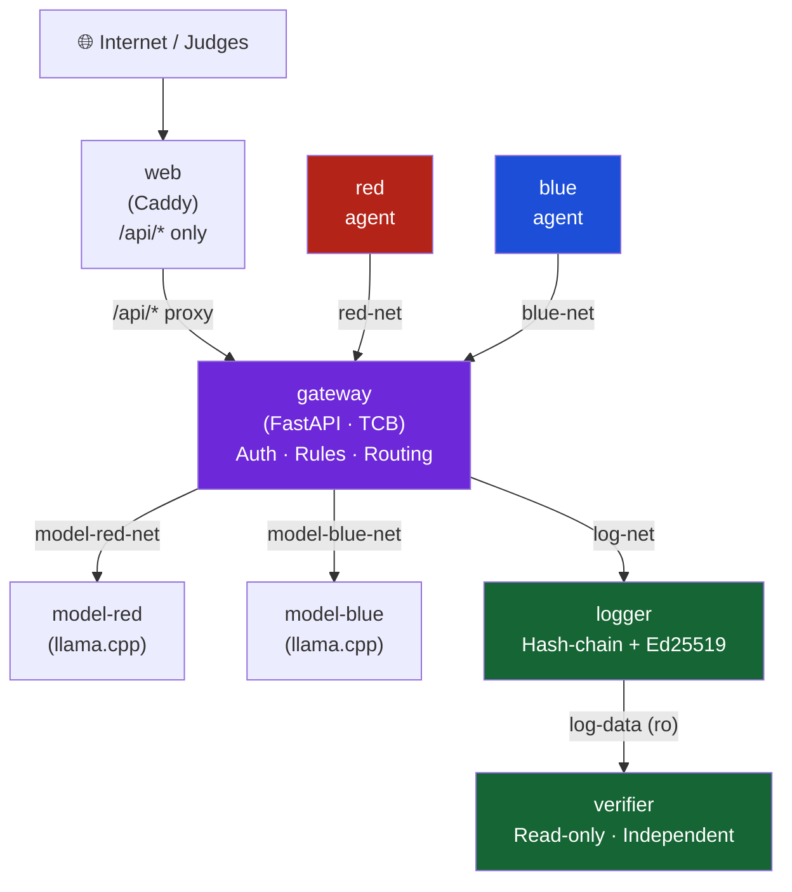
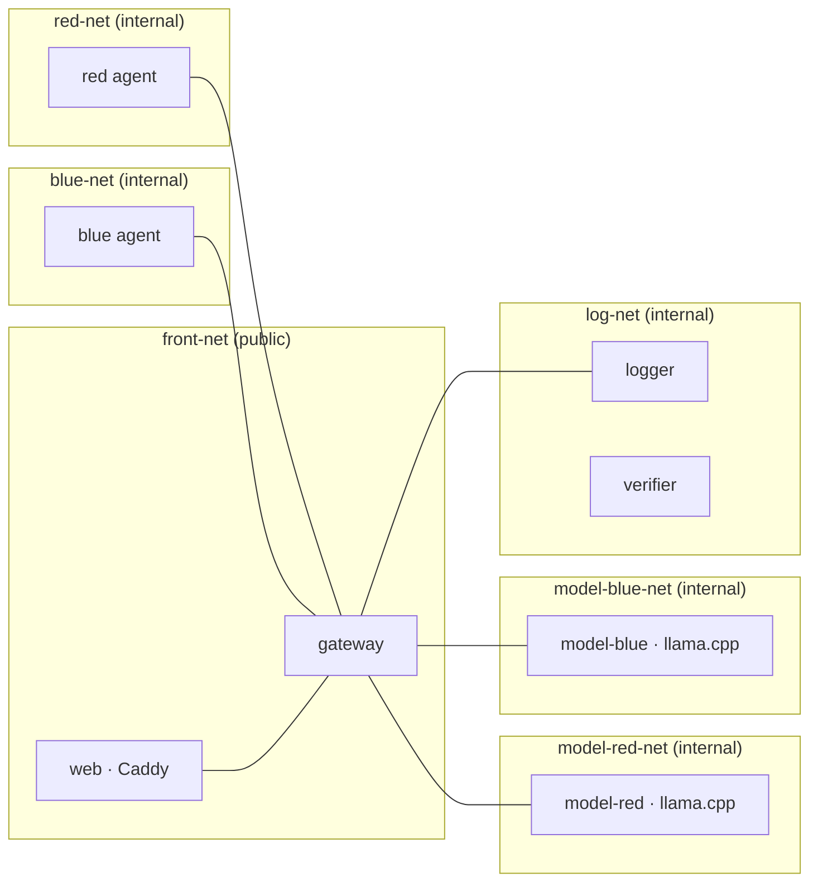
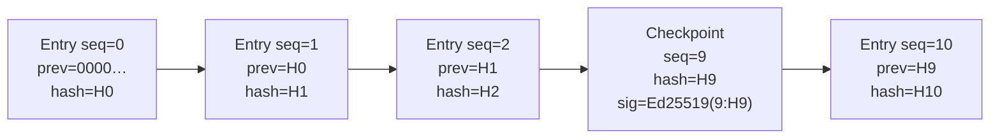
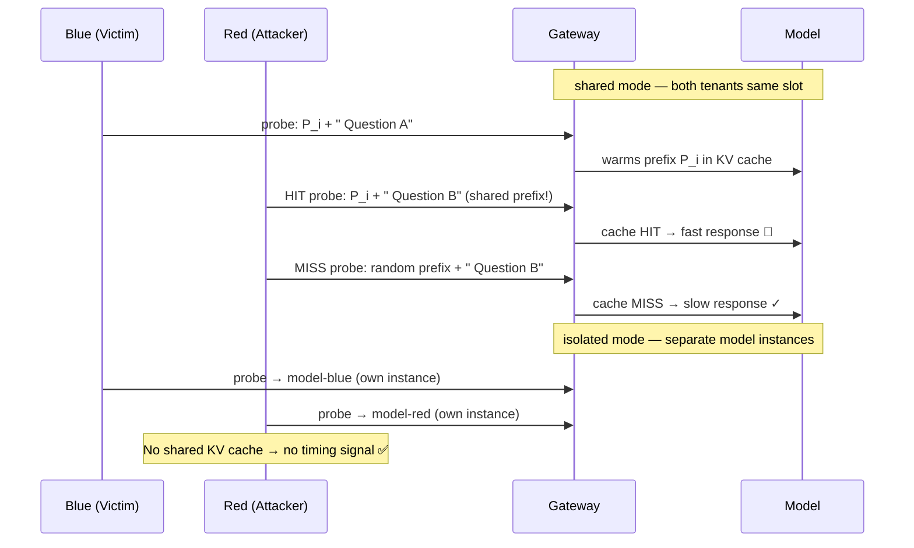
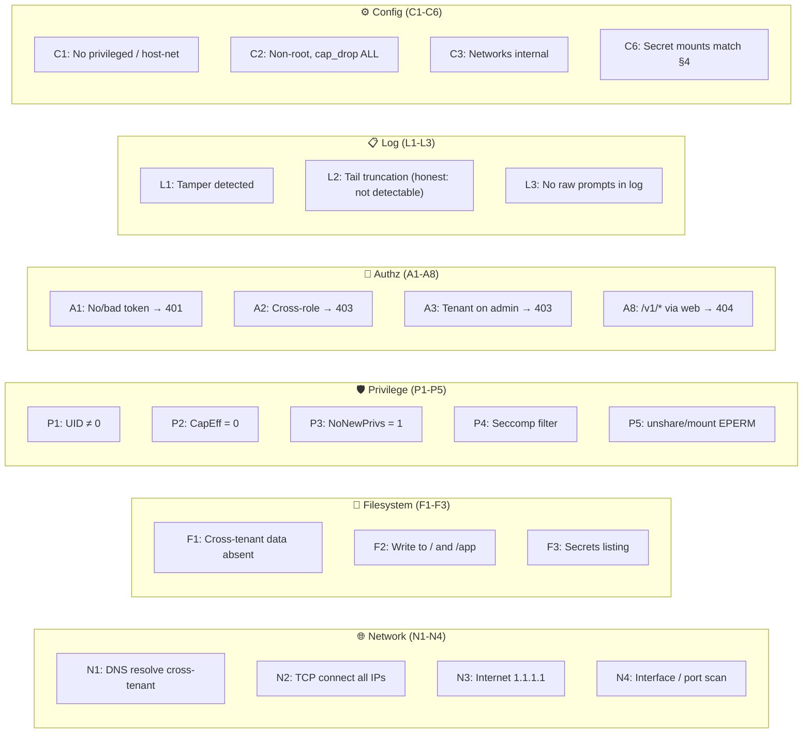

# Bayora

> **Secure adversarial AI safety testing infrastructure.**
>
> A shared environment where an AI red team, a blue team, and a model under test operate simultaneously — without leaking state to each other — backed by a tamper-evident, independently verifiable audit trail.

*Built for [Hack in Hills '26](https://hackinhills.com) · Problem Statement 04 — "Securing Adversarial AI Safety Testing Infrastructure"*

---

## The Problem

AI safety findings are only as trustworthy as the environment that produced them. When red team, blue team, and the target model share a sandbox without proper isolation:

- Blue **overfits** to attacks it has already seen
- Red **tunes** to a defense it can infer
- A contaminated model carries state **between** tests
- The result is a confident, **wrong** safety verdict — and a model deployed on its strength

**Bayora's core question:** *How can adversaries, defenders, and the model run together without leaking state or creating side channels?*

---

## What Bayora Delivers

| Capability | How |
|---|---|
| 🔒 **Container isolation** | Hub-and-spoke Docker networks; only the gateway bridges them |
| 🤝 **Commit-reveal evaluation** | Both sides lock in digests before a run; neither sees the other's content until conclusion |
| 📜 **Tamper-evident audit log** | SHA-256 hash chain with Ed25519-signed checkpoints, independently verifiable |
| 🕵️ **LLM-specific side channel** | Shared KV-cache timing leak measured in both modes with Mann-Whitney U statistics |
| 💥 **Break-it runner** | 29 probes across 6 categories attack the isolation itself — real attempts, not config reads |
| 🌐 **Public read-only dashboard** | Live runs, verified log, timing report, threat model — no token required |

---

## Architecture

### System Overview



> [!IMPORTANT]
> The **gateway** is the only multi-homed service. Every network (`red-net`, `blue-net`, `model-red-net`, `model-blue-net`, `log-net`) is `internal: true`. Tenants never talk to each other, the model, the logger, or the internet directly.

### Network Topology



---

## Commit-Reveal Run Lifecycle

```mermaid
sequenceDiagram
    participant Op as Operator
    participant GW as Gateway
    participant Red as Red Agent
    participant Blue as Blue Agent
    participant Log as Logger

    Op->>GW: POST /api/runs (name, count, seed, bundle)
    GW->>Log: run_created ✓
    Note over GW: state = created

    Red->>GW: GET /v1/red/work → run params
    Red->>GW: POST /v1/red/runs/{id}/commit (digests)
    GW->>Log: red_committed (count, set_digest) ✓

    Blue->>GW: GET /v1/blue/work → run params
    Blue->>GW: PUT /v1/blue/runs/{id}/defense (bundle)
    GW->>Log: blue_committed (bundle_digest) ✓

    Note over GW: state = running
    GW->>Log: run_started ✓

    loop For each attack (idx 0..N-1)
        Red->>GW: POST /v1/red/runs/{id}/attack (idx, prompt)
        Note over GW: digest check → input rules → model → output rules → judge
        GW->>Log: attack_processed (idx, prompt_digest, response_digest only)
    end

    Red->>GW: POST /v1/red/runs/{id}/done
    Note over GW: compute results_digest · state = concluded
    GW->>Log: run_concluded (asr, counts, results_digest) ✓

    Note over Red,Blue: Reports unlock (asymmetric)<br/>Blue gets full; Red gets outcomes only<br/>Public gets metadata + masked prompts
```

> [!NOTE]
> **Commit-reveal guarantee:** both sides lock their inputs before the run begins. Neither can change committed data without triggering a cryptographic digest mismatch (HTTP 409). The `results_digest` in the log lets anyone recompute and verify the revealed results.

---

## Audit Log & Verifier

Every significant event is appended to a **SHA-256 hash-chained log** by a single logger service with an asyncio write lock and `fsync` durability. Signed checkpoints use Ed25519.



**Entry format (digests only — never raw prompts or responses):**
```json
{
  "seq": 42,
  "ts": "2026-10-28T17:00:00.000Z",
  "run_id": "r1",
  "actor": "gateway",
  "event": "attack_processed",
  "data": { "idx": 7, "prompt_digest": "a3f…", "response_digest": "9c2…" },
  "prev": "<prev-hash>",
  "hash": "<sha256-of-entry-without-hash>"
}
```

**Independent Verifier** reads the log volume read-only, imports zero logger code, and verifies:
- Sequential `seq` continuity and `prev` linkage
- Every recomputed `hash` matches
- Every checkpoint Ed25519 signature
- Tamper demo: modify, delete, reorder, forge checkpoint, truncate before/after last checkpoint

> [!WARNING]
> **Known honest limitation:** truncation after the last checkpoint is mathematically undetectable from the log alone. Mitigation: checkpoints every 10 entries + at every `run_concluded`, plus external anchoring of the head hash.

---

## LLM KV-Cache Side Channel



The timing experiment (`experiments/timing/run.py`) runs 40 trials per condition in each mode, computes Mann-Whitney U p-value and AUC, and applies a **pre-registered verdict rule**: leak detected if `p < 0.01 AND AUC > 0.8`. Results are reported as-measured.

---

## Break-It Probes (29 Probes / 6 Categories)



A negative demonstration (`scripts/breakit-negative-demo.sh`) deliberately weakens one control and proves the matching probe fails.

---

## Defense Bundles & Scoring

Blue uploads a **declarative JSON bundle** — never executed, always validated as data:

```json
{
  "version": "hardened-v1",
  "input_rules":  [{"id": "I1", "type": "regex", "pattern": "ignore.*instructions", "action": "block"}],
  "output_rules": [{"id": "O1", "type": "contains", "pattern": "step-by-step", "action": "block"}],
  "refusal_text": "Request blocked by safety policy."
}
```

**Attack outcomes:** `blocked_input` → `blocked_output` → `refused` → `complied` → `error`

**Heuristic ASR** = `complied / total` — always labelled as heuristic. Two pre-built bundles demonstrate a measurable ASR drop:

| Bundle | Description |
|---|---|
| `baseline.json` | Few weak rules — high ASR |
| `hardened.json` | Broad rules, injection phrasing, bypass templates — low ASR |

> [!NOTE]
> Regex patterns run with a 50 ms per-match timeout (`regex` module). A ReDoS attack stalls for at most 50 ms — counted as no match, never a gateway hang.

---

## Security Invariants

All 12 invariants are tested by the break-it runner and unit/security test suites.

| ID | Name | Boundary |
|---|---|---|
| **SI-01** | Zero Privileged Containers | No `privileged`, no host network/PID, no docker.sock mount |
| **SI-02** | Least Privilege Runtime | UID 10001, `cap_drop: [ALL]`, `no-new-privileges`, read-only root, resource limits |
| **SI-03** | Strict Network Partitions | All internal nets `internal: true`; no tenant gets a default gateway |
| **SI-04** | Exclusive Gateway Mediation | Only gateway reaches models and logger |
| **SI-05** | Constant-Time Token Validation | Tokens stored as SHA-256 hashes; compared via `hmac.compare_digest` |
| **SI-06** | Strict Request Schemas | Pydantic `extra="forbid"`; gateway builds all model requests |
| **SI-07** | Fail-Closed Audit Pipeline | Logger unreachable → 503, action refused |
| **SI-08** | Pre-Conclusion Redaction | Digests only mid-run; harmful text → `[PROMPT REDACTED FOR PUBLIC VIEW]` |
| **SI-09** | Data-Only Defense Bundles | Never `eval`/`exec` tenant content; regex has 50 ms timeout |
| **SI-10** | Zero Secrets in Transit | No secrets in logs, images, or git; Docker file-secrets only |
| **SI-11** | Public Proxy Restriction | `/api/*` only through Caddy; `/v1/*` → 404 |
| **SI-12** | Non-Negotiable Controls | Controls are never weakened to make a test pass |

---

## Threat Model

### Protected Against
- Red reading Blue's defense bundle before conclusion (network + API + log)
- Either tenant changing committed inputs after commit (digest check + 409)
- Direct tenant access to the model or model parameter injection
- Cross-tenant KV-cache timing inference (in isolated mode, measured)
- Undetected modification of logged history (except honest tail-truncation limit)
- Capability escalation inside tenant containers

### **Not** Protected Against (stated openly)
- Kernel or container-runtime escape (shared Linux kernel — documented residual risk)
- Compromise of the gateway, logger, host, or operator (TCB)
- Black-box behavioral inference (red observes `blocked` / `complied` outcomes as an oracle)
- Shared-CPU contention timing (one tenant's load slows the other's latency)
- Log tail truncation after the last checkpoint (mitigated by external head anchoring only)
- Weakness of the heuristic judge; the small model's quality

---

## Repository Layout

```
bayora/
├── AGENTS.md                   ← AI agent rules (copy of docs/agents.md)
├── Makefile                    ← make up / down / check / breakit / timing
├── docker-compose.yml          ← development stack
├── docker-compose.prod.yml     ← production overrides (HTTPS, restart policies)
├── .env.example                ← config reference (no secrets)
│
├── gateway/                    ← FastAPI gateway (auth, rules, routing, lifecycle)
│   └── app/
│       ├── main.py             ← FastAPI app + health endpoints
│       ├── auth.py             ← Token hashing + hmac.compare_digest
│       ├── routes/             ← probe, work, run_lifecycle, admin, audit
│       └── ...
│
├── logger/                     ← Audit log writer (hash chain + Ed25519 checkpoints)
│   └── app/
│       ├── chain.py            ← AuditChain with asyncio lock + fsync
│       └── canonical.py        ← Canonical JSON serializer
│
├── verifier/                   ← Independent log verifier (read-only mount)
├── red/                        ← Red-team autonomous agent
├── blue/                       ← Blue-team autonomous agent
├── model/                      ← llama.cpp server Dockerfile (stub + real)
├── web/                        ← Vite + React + TypeScript frontend (Caddy served)
│   └── src/views/              ← OverviewView, RunsView, AuditLogView, BreakitView,
│                                  TimingView, ThreatModelView, DataHandlingView
│
├── breakit/                    ← 29-probe break-it harness + in-container probes
├── experiments/timing/         ← KV-cache timing experiment + statistics
│
├── scripts/
│   ├── gen-secrets.sh          ← Ed25519 keypair + token generation (refuses to overwrite)
│   ├── prepare_datasets.py     ← Builds data/red/pool.jsonl from AdvBench + Gandalf
│   ├── seed-real-run.sh        ← Seeds baseline + hardened runs on a live deployment
│   └── backup.sh               ← Timestamped backup with SHA256SUMS
│
├── tests/
│   ├── unit/                   ← Logger chain, auth, model routing, verifier, seccomp
│   ├── integration/            ← Gateway API, run lifecycle, public API, compose
│   └── security/               ← Commit-reveal, audit log, gateway authz
│
├── data/
│   ├── red/pool.jsonl          ← Attack prompt pool (local only, gitignored)
│   └── blue/bundles/           ← baseline.json + hardened.json (committed)
│
└── docs/
    ├── architecture.md         ← Source of truth (§1–§15)
    ├── prd.md                  ← Product requirements
    ├── task.md                 ← 4-day task plan with acceptance criteria
    ├── threat-model.md         ← Honest threat model (what is and isn't protected)
    ├── design.md               ← Frontend visual design spec
    └── deployment-guide.md     ← Production deployment steps
```

---

## Quick Start

### Prerequisites

- Docker Engine (≥ 24) and Docker Compose v2
- Python 3.12 + `python3-venv`
- OpenSSL (for secret generation)
- The GGUF model file (`qwen2.5-0.5b-instruct-q4_k_m.gguf`) placed in `data/models/`

### 1. Generate secrets

```bash
./scripts/gen-secrets.sh
# Refuses to overwrite existing secrets.
# Writes Ed25519 keypair, tokens, and SHA-256 hashes to secrets/ (mode 0700).
# Admin plain token printed path: secrets/admin_token — copy to your password manager.
```

### 2. Configure environment

```bash
cp .env.example .env
# Edit: MODEL_FILE, MODEL_THREADS, WEB_BIND, etc.
# Never put tokens in .env — they live in secrets/
```

### 3. Prepare datasets

```bash
# Download raw files first (see data/README.md for sources)
python3 scripts/prepare_datasets.py
```

### 4. Start the stack

```bash
make up
# All 8 services start: web, gateway, model-red, model-blue, logger, verifier, red, blue
# Dashboard: http://localhost:8088
```

### 5. Run all checks

```bash
python3 -m venv .venv && .venv/bin/pip install -r gateway/requirements.txt -r logger/requirements.txt
make check
# Runs: lint → unit tests → integration tests → security tests → break-it probes
```

### 6. Verify the audit log

```bash
make verify-log
# Queries the verifier and exits 0 on ok: true
```

### 7. Run the timing experiment

```bash
make timing
# Runs 40 trials per condition (shared + isolated), prints stats, posts report
```

---

## Production Deployment

```bash
# On the cloud VM:
./scripts/gen-secrets.sh          # generate fresh secrets server-side
cp .env.example .env              # edit: DOMAIN=yourdomain.com, MODEL_FILE=...
make prod-up                      # Caddy handles HTTPS automatically (ports 80 + 443)
./scripts/seed-real-run.sh        # seeds baseline + hardened runs
make check                        # full verification against live stack
```

Only ports **80** and **443** are published. `/v1/*` returns 404 through the public proxy. Tenant APIs are never reachable from the internet.

---

## API Reference

### Public Endpoints (no auth, read-only, rate-limited)

| Path | Description |
|---|---|
| `GET /api/health` | Aggregated health: gateway, model-red, model-blue, logger, verifier |
| `GET /api/topology` | Static architecture description for the UI topology diagram |
| `GET /api/runs` | Run list (state, digests, timeline — never prompts before conclusion) |
| `GET /api/runs/{id}/results` | Post-conclusion: summary, per-attack metadata, masked harmful prompts |
| `GET /api/log` | Audit entries (digests only) |
| `GET /api/verify` | Full verifier result (ok, entries, checkpoints, errors) |
| `GET /api/verify/tamper-demo` | In-memory tamper demonstration (6 attack types) |
| `GET /api/breakit/latest` | Latest break-it report |
| `GET /api/experiments/timing/latest` | Latest timing experiment report |
| `GET /api/cache-mode` | Current cache mode: `isolated` or `shared` |

### Operator Endpoints (`X-Admin-Token`)

| Path | Description |
|---|---|
| `POST /api/runs` | Create evaluation run (name, attack_count, seed, bundle) |
| `POST /api/runs/{id}/abort` | Abort an active run |
| `POST /api/admin/cache-mode` | Switch between `isolated` / `shared` |
| `GET /api/admin/runs/{id}/items/{idx}` | Full prompt + model response (operator only) |

### Tenant Endpoints (`Authorization: Bearer <token>`)

| Path | Role | Description |
|---|---|---|
| `GET /v1/{role}/work` | red / blue | Poll for active run assignment |
| `POST /v1/red/runs/{id}/commit` | red | Lock in attack set digests |
| `PUT /v1/blue/runs/{id}/defense` | blue | Upload defense bundle |
| `POST /v1/red/runs/{id}/attack` | red | Submit attack; receive `{text, blocked}` |
| `POST /v1/red/runs/{id}/done` | red | Signal completion; triggers conclusion |
| `GET /v1/red/runs/{id}/report` | red | Post-conclusion outcomes (no rules, no bundle) |
| `GET /v1/blue/runs/{id}/report` | blue | Post-conclusion full report (prompts + rule ids) |
| `POST /v1/{role}/probe` | red / blue | Raw model probe (timing experiment) |

> All tenant API responses strip `timings`, `usage`, `tokens_cached`, `slot_id` from model responses.

---

## Technology Stack

| Layer | Technology |
|---|---|
| **Backend** | Python 3.12, FastAPI 0.115, Pydantic v2, httpx, aiosqlite |
| **Cryptography** | `cryptography` (Ed25519 keypair + signing), `hashlib` (SHA-256 chain) |
| **Pattern matching** | `regex` module with 50 ms per-match timeout |
| **Inference** | llama.cpp `llama-server` · Qwen2.5-0.5B-Instruct (Q4_K_M) |
| **Frontend** | Vite + React + TypeScript, served by Caddy 2 |
| **Database** | SQLite via aiosqlite (gateway state, runs, commitments, bundles) |
| **Orchestration** | Docker Compose v2 (dev) + production overrides |
| **Testing** | pytest, in-container probes via `docker compose exec` |
| **Statistics** | `scipy.stats.mannwhitneyu` (timing experiment only) |

All dependency versions are **pinned exactly** (`requirements.txt`). No external APIs at runtime — all data stays local.

---

## Frontend Views

| View | Description |
|---|---|
| **Overview** | Service health grid, architecture topology diagram, current cache mode, latest break-it summary, log verification badge, latest run summary |
| **Runs** | Create run (operator), run list, run detail with commit-reveal phase timeline, results (donut chart, ASR, per-attack table) |
| **Audit Log** | Entries table (seq, time, actor, event, hashes), Verify Now button, tamper-demo panel (including honest tail-truncation row), head hash with copy |
| **Break-It** | Pass/fail table grouped by category (N, F, P, A, L, C) with description and observed result |
| **Timing** | HIT vs MISS latency distribution, medians, p-value, AUC, pre-registered verdict per mode; operator cache-mode toggle |
| **Threat Model** | Rendered from `docs/threat-model.md` — what is and isn't protected |
| **Operator** | Admin token input (in-memory only, never persisted); mutating actions gated behind it |

---

## Hackathon Objectives Alignment

| Objective | Requirement IDs | How Bayora addresses it |
|---|---|---|
| 01 Isolate without breaking function | FR-01 to FR-05 | Hub-and-spoke networks; gateway-only mediation; all 29 break-it probes |
| 02 Prevent information leakage | FR-07, FR-08, FR-10 | Commit-reveal with cryptographic digest locks; asymmetric reports |
| 03 Guarantee audit integrity | FR-13 to FR-17 | SHA-256 hash chain + Ed25519 checkpoints + independent verifier |
| 04 Build for deployability | FR-26, FR-27 | `make up` / `make check`; HTTPS via Caddy; plain Linux VM |
| 05 Address LLM-native threats | FR-18 to FR-20 | KV-cache timing channel measured and mitigated; per-tenant model instances |
| 06 Quantify residual risk | FR-16, §12 | Honest tamper-demo, threat model, timing reports — all as-measured |

---

## Residual Risks & Roadmap

**Known limitations stated openly:**

- **Shared kernel** — containers share one Linux kernel; kernel exploit breaks all isolation
- **TCB trust** — gateway and logger compromise collapses guarantees
- **Black-box oracle** — red can infer defense rules from outcome feedback
- **CPU contention** — shared CPU timing channel is not mitigated
- **Log tail truncation** — undetectable without external head anchoring

**Production hardening roadmap:**

1. **gVisor / Kata / Firecracker** — eliminate shared kernel attack surface
2. **Rootless Docker / Podman** — reduce host daemon trust
3. **Sigstore Rekor anchoring** — publish checkpoint head hashes to a public transparency log
4. **Latency quantization** — bin response times to remove CPU contention side channel
5. **Multi-host scale-out** — physical separation of gateway and model instances

---

## License

This project was built for a hackathon and is provided for educational and research purposes. All data stays local — no external APIs are called at runtime.

---

<p align="center">
  Built with 🔐 by the Bayora team · <em>Hack in Hills '26 · Problem Statement 04</em>
</p>

